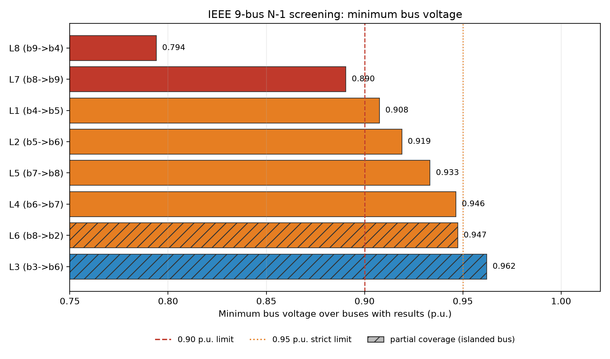
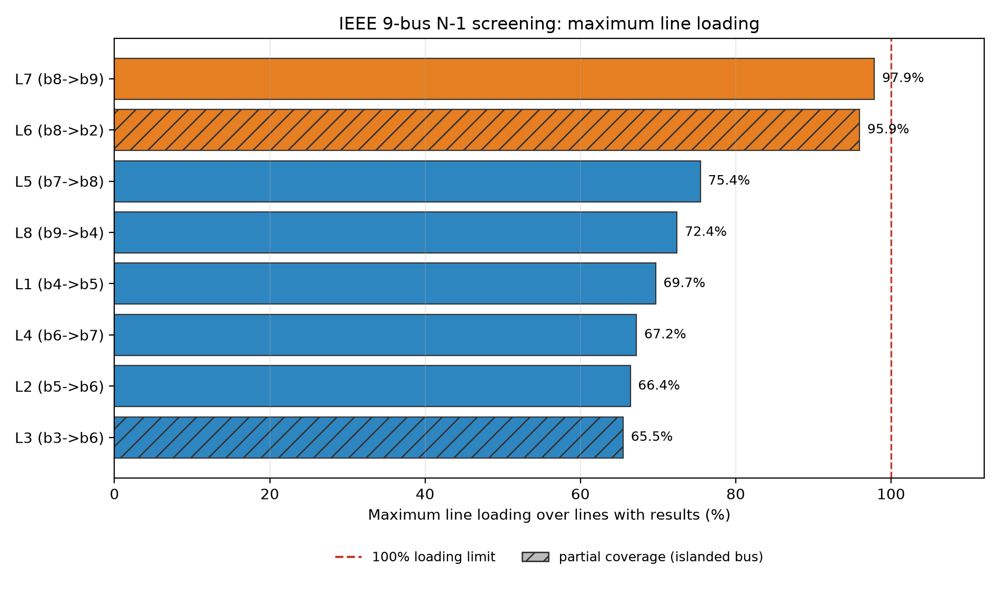

# IEEE 9 节点系统交流潮流与线路 N-1 筛查

> 个人学习项目。使用 pandapower 内置 IEEE 9 节点测试算例，不代表任何真实电网的
> 安全性结论，也不构成工程咨询成果。

## 1. 项目摘要

本报告研究对象为 IEEE 9 节点交流输电测试系统，分析目标是在基准运行方式和线路
N-1（逐条退出单回线路）条件下，考察母线电压与线路负载率的变化范围，识别越限、
高负载、拓扑孤岛与无有效结果的场景。

分析使用 pandapower 3.5.6 的牛顿—拉夫逊交流潮流，对 9 条线路逐一开断后重新求解，
并以「收敛性 / 结果有效性 / 约束符合性」三层判据分别判定每个场景。

主要结果（全部可在 `data/n1_results.csv` 与 `data/base_case.json` 中复核）：

- 基准潮流 3 次迭代收敛，母线电压 0.9576–1.0034 p.u.，最大线路负载率 65.46%
  （线路 `L6`，母线 8→2），两组电压判据下均无越限；
- 9 个 N-1 场景中，**6 个**结果覆盖全部 9 个母线与 9 条线路，属全网有效场景；
  **2 个**因开断导致一个母线被隔离，只有 8 个母线有结果；**1 个**失去平衡节点，
  仅剩 1 个母线有结果；
- 全网有效场景中，最低母线电压 0.794 p.u.（`L8`，母线 9→4 退出），最大线路负载率
  97.86%（`L7`，母线 8→9 退出）；无场景超过 100% 线路负载率。

结果适用于该标准算例的静态交流潮流分析，不外推到真实电网，也不涉及暂态稳定、
保护动作、无功限值或概率性分析。

## 2. 研究背景与分析目标

N-1 准则是输电系统静态安全分析的常用筛查手段：在基准潮流基础上逐一退出单个
元件，检查剩余网络是否仍满足电压与热稳定约束。工程上常把「潮流收敛」当作计算
成功的标志，但在拓扑被切开的情况下，求解器可能仍返回收敛标志，而结果只覆盖
网络的一部分。因此仅凭收敛标志判断场景有效性会产生系统性偏差。

本项目要回答的问题是：

1. 基准运行方式下，母线电压与线路负载率处于什么范围？
2. 线路退出运行后，网络潮流与关键运行指标如何变化？
3. 哪些场景出现电压越限、线路高负载、拓扑孤岛或无有效结果？
4. 为什么不能仅凭潮流求解器的收敛标志判断结果有效或系统安全？

## 3. 测试系统与建模条件

**数据来源**：`pandapower.networks.case9()`，即 pandapower 内置的 IEEE 9 节点算例，
未修改任何母线、线路、负荷或发电机参数。

**系统构成**（由脚本实测，非按常见配置补写）：

| 项目 | 数量/取值 |
|---|---|
| 母线 | 9（`bus.name` 标为 "1"–"9"） |
| 线路 | 9（无变压器，`trafo` 表为空） |
| 负荷 | 3 |
| 发电机 | 2（另有 1 个外部电网等值 `ext_grid` 作为平衡节点） |
| 平衡节点 | 母线 1（索引 0） |
| 线路额定电流 | 0.251 / 0.418 / 0.502 kA 三种规格（按算例原始数据） |

**编号约定**：线路用 pandapower 的 0-based 索引 `L0`–`L8`；母线用算例自带的
1–9 编号（等于 pandapower 索引 +1）。两者在 `data/n1_results.csv` 中分别以
`outaged_line` 与 `from_bus_label` / `to_bus_label` 记录，图与表使用同一约定。

**求解设置**（脚本常量，见 `src/n1_analysis.py`）：

| 参数 | 取值 |
|---|---|
| 算法 | 牛顿—拉夫逊（`algorithm="nr"`） |
| 最大迭代次数 | 10 |
| 收敛容差 | 1e-8 MVA |
| 电压相角 | 计算（`calculate_voltage_angles=True`） |
| numba 加速 | 关闭 |

**判据定义**（本项目自设的分析阈值，非统一强制标准）：

- 主电压判据：0.90 ≤ U ≤ 1.10 p.u.；
- 辅助电压判据：0.95 ≤ U ≤ 1.05 p.u.，用于观察运行裕度；
- 线路负载率：`loading_percent`（电流与线路自身 `max_i_ka` 之比）不超过 100%。

## 4. 计算方法与结果判定

### 4.1 基准潮流

对 `case9()` 的深拷贝执行一次交流潮流，提取母线电压幅值 `res_bus.vm_pu` 与线路
负载率 `res_line.loading_percent`，记录收敛状态、迭代次数、极值及其位置。

### 4.2 N-1 扫描

对每条线路执行：

1. `copy.deepcopy(base_net)` 复制网络；
2. 将该条线路 `in_service` 置为 `False`；
3. 重新求解交流潮流；
4. 记录电压、负载率、越限计数与结果覆盖情况。

不使用 PowerMCP 的 `run_contingency_analysis`：该工具内部调用了 `pandapowerNet`
不存在的 `deepcopy()` 方法，属于工具侧缺陷。此处使用标准库 `copy.deepcopy` 达到
相同目的，方法上无差异。

### 4.3 三层判定

三个概念在本报告中严格区分：

| 层次 | 含义 | 依据字段 |
|---|---|---|
| 求解收敛性 | 求解器是否报告收敛 | `converged` |
| 结果有效性 | 结果是否覆盖分析网络的全部母线/线路 | `buses_with_results`、`lines_with_results`、`n_components`、`islanded_buses` |
| 约束符合性 | 有效结果是否满足电压与负载率判据 | `voltage_violations`、`strict_voltage_violations`、`line_overloads` |

### 4.4 场景状态定义

| `status` | 判定条件 | 解释 |
|---|---|---|
| `ok` | 拓扑连通分量数 = 1 且所有母线、线路均有结果 | 全网有效场景 |
| `partial_coverage_islanded` | 拓扑连通分量数 > 1，且仍有 ≥2 个母线、≥1 条线路有结果 | 部分网络被隔离，指标仅代表带电分区 |
| `islanded_no_valid_results` | 有结果的母线 < 2 或线路 = 0 | 失去电源或全网无有效结果 |
| `error` | 求解抛出异常 | 计算失败，未产生结果 |

拓扑连通性由 `in_service` 的线路与变压器构建（并查集），与求解器返回的 `NaN`
分布相互印证：`islanded_buses` 记录不含平衡节点的分区中的母线。

**指标空值处理**：`islanded_no_valid_results` 场景的电压、负载率与越限计数一律
留空，不填 0，也不计入「无越限」统计；`partial_coverage_islanded` 场景的指标
只在有结果的母线与线路上统计，并在结果中显式标注。

**关于判定逻辑的修订**：早期脚本以 `len(vm) >= 2` 作为有效性判据，只能排除
「几乎全网失效」的情形。该判据会把 `L3`、`L6` 这类「隔离一个母线、仍有 8 个
母线有结果」的场景误判为全网有效。现改为「连通分量 + 结果覆盖度」联合判定。
修订后所有场景的电压、负载率数值与原结果完全一致（最大绝对差 0.0），仅状态
分类发生变化。

## 5. 基准潮流结果

数据来源：`data/base_case.json`（由脚本自动生成）。

| 指标 | 结果 |
|---|---|
| 收敛 | 是，3 次迭代 |
| 母线电压范围 | 0.9576–1.0034 p.u. |
| 最低电压母线 | 母线 9 |
| 最高电压母线 | 母线 6 |
| 最大线路负载率 | 65.46%（线路 `L6`，母线 8→2） |
| 0.90–1.10 p.u. 电压越限 | 0 |
| 0.95–1.05 p.u. 电压越限 | 0 |
| 线路过载（>100%） | 0 |

基准场景在两组电压判据下均无越限，最大负载率 65.46%，存在较大热稳定裕度。

## 6. N-1 计算结果

### 6.1 结果汇总

「有效母线/线路」为该场景有潮流结果的母线数与线路数（总数为 9/9）。
「越限母线数」按有结果的母线与线路统计；空白表示该场景无有效结果，不作统计。

| 线路（索引） | 母线 | `status` | 迭代 | 有效母线/线路 | 最低电压 (p.u.) | 严格判据越限母线 | 主判据越限母线 | 最大负载率 | 被隔离母线 |
|---|---|---|---:|---|---:|---:|---:|---:|---|
| `L0` | 1→4 | islanded | 1 | 1 / 0 | — | — | — | — | 2–9 |
| `L1` | 4→5 | ok | 4 | 9 / 9 | 0.9076 | 1 | 0 | 69.69% | — |
| `L2` | 5→6 | ok | 4 | 9 / 9 | 0.9190 | 2 | 0 | 66.42% | — |
| `L3` | 3→6 | **partial** | 3 | 8 / 8 | 0.9622 | 0 | 0 | 65.50% | 3 |
| `L4` | 6→7 | ok | 3 | 9 / 9 | 0.9465 | 1 | 0 | 67.22% | — |
| `L5` | 7→8 | ok | 4 | 9 / 9 | 0.9333 | 2 | 0 | 75.44% | — |
| `L6` | 8→2 | **partial** | 3 | 8 / 8 | 0.9474 | 1 | 0 | 95.94% | 2 |
| `L7` | 8→9 | ok | 4 | 9 / 9 | 0.8905 | 2 | 1 | 97.86% | — |
| `L8` | 9→4 | ok | 5 | 9 / 9 | 0.7940 | 1 | 1 | 72.45% | — |

`islanded` = `islanded_no_valid_results`，`partial` = `partial_coverage_islanded`。

### 6.2 场景统计

| 分类 | 数量 | 场景 |
|---|---:|---|
| 全网有效（`ok`） | 6 | `L1` `L2` `L4` `L5` `L7` `L8` |
| 部分覆盖（`partial`） | 2 | `L3` `L6` |
| 无有效结果（`islanded`） | 1 | `L0` |
| 求解失败（`error`） | 0 | — |

所有 9 个场景 `converged = True`，包括无有效结果的 `L0`。这说明收敛标志不能替代
有效性判定。

### 6.3 图表





图中斜线填充表示该场景只有部分网络有结果（`partial`）。`L0` 无有效结果，不进入
两张图；坐标轴用英文以规避字体依赖，编号与上表一致（`L<索引>`、`b<母线号>`）。

## 7. 结果分析与技术讨论

### 7.1 可直接由数据支持的发现

1. 基准场景 9 个母线、9 条线路均有结果，无越限，最大负载率 65.46%。
2. 6 个全网有效场景的最低电压分布在 0.7940–0.9465 p.u.，最大负载率分布在
   66.42%–97.86%，跨度较大，说明该算例对开断位置敏感。
3. 主判据（0.90–1.10 p.u.）下仅 `L7`、`L8` 出现电压越限，各 1 个母线；
   线路负载率全部低于 100%，最高 97.86%。
4. 辅助判据（0.95–1.05 p.u.）下，6 个全网有效场景全部至少有一个母线越限，
   `L7`、`L5`、`L2` 各 2 个母线，`L1`、`L4`、`L8` 各 1 个。
5. 9 个场景全部报告收敛；`L0` 收敛时只有 1 个母线、0 条线路有结果。
6. `L3`、`L6` 各有 1 个母线无结果，分别对应母线 3 与母线 2 所在分区的隔离。

### 7.2 基于拓扑的合理解释

- **`L8`（9→4）退出后电压最低（0.794 p.u.）**：该线路退出后，母线 9 只剩线路
  `L7`（8→9）单回供电，而母线 9 本身带负荷。辐射状单回供电的电气距离更长，
  因此出现全组最深电压跌落。该解释基于拓扑与负荷位置，尚未做灵敏度或潮流
  追踪验证。
- **`L7`（8→9）退出后电压与负载同时逼近边界（0.890 p.u.、97.86%）**：母线 9 改由
  `L8`（9→4）供电，潮流在剩余通道上重新分布，负载率最高的线路不是与 9 号母线
  直接相连的线路，而是编号 `L2`（5→6）。这提示只观察与开断线路相邻的元件会
  低估影响范围。
- **`L6`（8→2）与 `L3`（3→6）**：被隔离的都是发电机母线（母线 2、母线 3）。
  剩余网络的电压与负载率指标仍可计算，但已不包含该发电机与相关线路，属于
  「部分覆盖」。`L6` 场景 95.94% 的负载率恰好出现在线路 `L0`（1→4），是潮流
  转移的结果；若按全网场景解读，会同时低估风险范围与误判作用域。

### 7.3 判据敏感性

两组电压判据给出的结论差异明显：主判据下 6 个全网场景中 2 个越限，辅助判据下
6 个全部越限。这说明「是否越限」强烈依赖判据取值，报告结论必须与判据绑定表述，
不能脱离判据谈「安全 / 不安全」。

### 7.4 本模型无法支持的判断

- 无法判断 N-1 后是否发生切负荷或失负荷量：模型未建立保护与低频减载逻辑，
  被隔离分区的负荷在结果中只表现为缺失数据；
- 无法判断暂态稳定、电压稳定裕度与短路电流水平；
- 无法评价变压器 N-1（该算例不含变压器）；
- 无法评价 N-1-1、多重故障与概率性风险；
- 无法验证 `L0` 场景的实际运行后果，因为该场景没有可用的全网潮流结果。

## 8. 结论

1. 在 pandapower 的 IEEE 9 节点算例上，基准潮流 3 次迭代收敛，母线电压
   0.9576–1.0034 p.u.，最大线路负载率 65.46%（`L6`，8→2），主判据与辅助判据
   下均无越限。
2. 9 个线路 N-1 场景中，6 个覆盖全网，2 个因母线隔离只有部分结果，1 个失去
   平衡节点而无有效结果；三者的区别来自拓扑连通性，不能由 `converged` 区分。
3. 全网有效场景中，最低电压 0.794 p.u.（`L8`），最大线路负载率 97.86%（`L7`）；
   所有场景负载率均未超过 100%。
4. 电压越限结论依赖判据：主判据下 6 个全网场景中 2 个越限，辅助判据下 6 个
   全部越限。
5. 该算例为静态、无变压器、无保护逻辑的标准测试系统，上述结果只说明该模型
   与判据下的计算现象，不构成对真实电网安全水平的判断。

## 9. 研究局限

- **测试系统差异**：IEEE 9 节点为小规模标准算例，网络结构、参数与真实区域电网
  差异明显，结果不具备工程代表性。
- **分析边界**：仅做线路 N-1，未做发电机、变压器与母线故障；未考虑检修叠加
  （N-1-1）。
- **模型范围**：静态交流潮流，负荷为恒功率模型；未考虑电压相关负荷、设备限值
  细节、无功限值与调压器动作。
- **判据来源**：0.90–1.10 与 0.95–1.05 p.u. 为本项目自设的分析阈值，用于观察
  裕度差异，不代表任何标准或调度规程。
- **部分覆盖场景**：`L3`、`L6` 的指标只代表带电分区，不能与全网场景直接比较；
  被隔离分区的供电能力、负荷损失与稳定问题均未分析。
- **无效场景**：`L0` 无全网结果，只能说明该开断导致平衡节点与主网分离，无法
  给出越限或过载结论。

## 10. 可复现性说明

环境：Windows + PowerShell，Python 3.13；实测依赖版本见 `requirements.txt`
（pandapower 3.5.6、pandas 2.3.3、matplotlib 3.11.2）。

```powershell
# 在仓库根目录执行
python -m venv .venv
.\.venv\Scripts\Activate.ps1
pip install -r requirements.txt

# 基线潮流 + N-1 扫描（约数秒）
python projects\01-ieee9-loadflow-n1\src\n1_analysis.py

# 生成两张图
python projects\01-ieee9-loadflow-n1\src\make_figures.py
```

**输入**：`pandapower.networks.case9()`（库内置算例，无外部数据文件）。

**输出**：

| 文件 | 内容 |
|---|---|
| `projects/01-ieee9-loadflow-n1/data/base_case.json` | 基准潮流指标、网络规模与求解设置 |
| `projects/01-ieee9-loadflow-n1/data/n1_results.csv` | 9 个 N-1 场景的逐项结果 |
| `projects/01-ieee9-loadflow-n1/figures/n1_min_voltage.png` | 最低母线电压对比 |
| `projects/01-ieee9-loadflow-n1/figures/n1_max_loading.png` | 最大线路负载率对比 |

**复核方式**：

1. 重跑脚本后 `git diff --stat`，若数据与图表均无差异，说明结果可复现；
2. 检查 `data/n1_results.csv` 行数为 9，且 `status` 分布为 6 / 2 / 1；
3. 检查 `data/base_case.json` 中 `iterations = 3`、`vmin_pu ≈ 0.9576`、
   `max_line_loading_percent ≈ 65.46`，与第 5 节一致。
