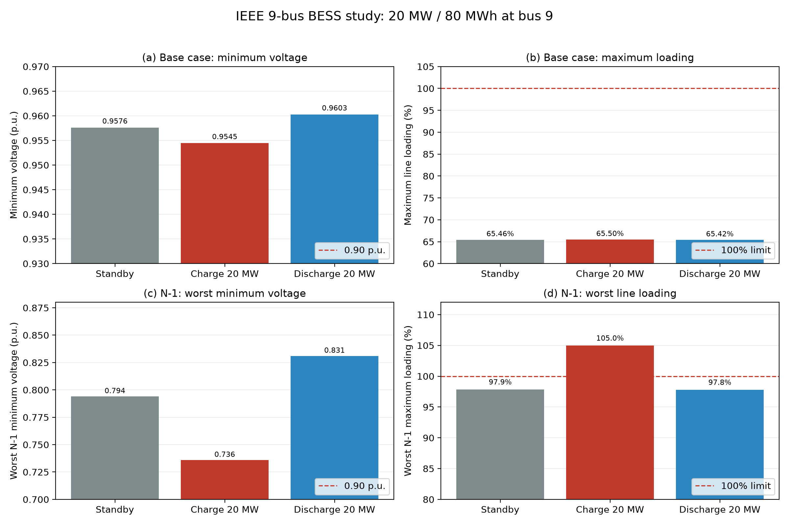
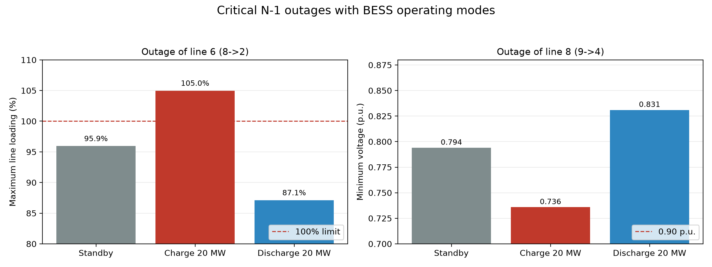

# 储能接入对 IEEE 9 节点系统潮流与 N-1 安全性的影响分析

> 个人学习项目。使用 pandapower 内置 IEEE 9 节点测试算例，代表的是一个 20 MW /
> 80 MWh 电池储能在三个运行模式下的静态潮流对比，不代表真实电网或真实储能系统的
> 运行结论，也不构成工程咨询成果。

## 1. 项目摘要

本报告研究对象为装有 20 MW / 80 MWh 电池储能（BESS）的 IEEE 9 节点测试系统，
储能接入母线 9，仅参与有功功率交换（`q_mvar = 0`）。分析目标是比较 **standby /
充电 +20 MW / 放电 −20 MW** 三种运行模式对基准潮流与线路 N-1 结果的影响。

方法：pandapower 牛顿—拉夫逊交流潮流，每种模式先算基准潮流，再对 9 条线路逐一
开断重算，共 27 个 N-1 场景；每个场景按「收敛性 / 结果有效性 / 约束符合性」三层
判定，有效性由拓扑连通分量与结果覆盖度共同决定。

主要结果（可在 `data/storage_base_results.csv`、`data/storage_n1_results.csv`
中复核）：

- 三种模式的基准潮流均无越限，最低电压 0.9545–0.9603 p.u.，最大负载率
  65.42%–65.50%，储能 ±20 MW 对基准指标的影响约 0.003 p.u. / 0.08 个百分点；
- 27 个 N-1 场景中 **18 个**结果覆盖全网、**6 个**因母线隔离只有部分网络有结果、
  **3 个**（每种模式的线路 0 开断）失去平衡节点而无有效结果；
- 全网有效场景中，三种模式的最差电压都出现在线路 8（9→4）开断：standby
  0.7940、充电 0.7358、放电 0.8310 p.u.；最大负载率均出现在线路 7（8→9）开断，
  97.80%–97.94%，无场景超过 100%；
- 线路 6（8→2）开断会隔离母线 2，指标只代表带电分区：该分区内充电模式出现
  104.98% 的线路过载，放电模式降至 87.12%。

结论的适用范围是：该标准算例、静态交流潮流、单一储能位置与单一功率档位、仅线路
N-1。

## 2. 研究背景与分析目标

储能接入配电网/输电网后，充放电功率会改变潮流分布。工程上常以「基准潮流无越限」
判断某运行方式安全，但 N-1 条件下潮流转移可能使原本轻载的线路接近或越过限值。
本项目要回答：

1. 三种运行模式下，基准潮流的电压与负载率处于什么范围？
2. 线路退出运行后，各模式的电压、负载率如何变化？差异有多大？
3. 哪些 N-1 场景出现电压越限、线路过载、拓扑孤岛或结果无效？
4. 储能能否缓解这些 N-1 场景，哪些场景是储能无法单独解决的？

## 3. 测试系统与建模条件

**数据来源**：`pandapower.networks.case9()`，未修改母线、线路、负荷、发电机参数；
储能通过 `pp.create_storage` 追加，不改变原有设备。

| 项目 | 取值 |
|---|---|
| 母线 / 线路 | 9 / 9（无变压器） |
| 负荷 / 发电机 / 平衡节点 | 3 / 2 / 1（母线 1） |
| 储能接入母线 | 母线 9（pandapower 索引 8） |
| 储能规模 | 20 MW / 80 MWh（4 小时） |
| 储能初始 SOC | 50%（仅作为参数写入，本分析不涉及时序） |
| 无功 | `q_mvar = 0` |
| 功率符号 | `p_mw > 0` 充电；`p_mw < 0` 放电；`= 0` standby |

**求解设置**（`src/n1_analysis.py` 常量）：

| 参数 | 取值 |
|---|---|
| 算法 | 牛顿—拉夫逊（`nr`） |
| 最大迭代次数 | 10 |
| 收敛容差 | 1e-8 MVA |
| 电压相角 | 计算 |
| numba 加速 | 关闭 |

**判据**（本项目自设分析阈值，非统一强制标准）：主判据电压 0.90–1.10 p.u.、
线路负载率 ≤ 100%；辅助判据电压 0.95–1.05 p.u.，用于观察裕度。

**编号约定**：线路用 pandapower 0-based 索引 `L0`–`L8`；母线用算例自带 1–9 编号。
CSV 中以 `outaged_line` 与 `from_bus_label`/`to_bus_label` 同时记录，图与表一致。

## 4. 计算方法与结果判定

### 4.1 流程

1. 对每种模式构建网络（case9 + 储能）并求解基准潮流；
2. 深拷贝网络，逐条把线路 `in_service` 置为 `False` 后重新求解；
3. 记录电压、负载率、越限计数与结果覆盖情况；
4. 按 4.2 的分类汇总，全网有效场景单独统计，部分覆盖场景单列。

### 4.2 三层判定与场景状态

| 层次 | 含义 | 字段 |
|---|---|---|
| 求解收敛性 | 求解器是否报告收敛 | `converged` |
| 结果有效性 | 结果是否覆盖全部 9 个母线 / 9 条线路 | `buses_with_results`、`status`、`islanded_buses` |
| 约束符合性 | 有效结果是否满足电压与负载率判据 | `voltage_violations`、`strict_voltage_violations`、`line_overloads` |

| `status` | 条件 | 指标含义 |
|---|---|---|
| `ok` | 连通分量 = 1，全部母线/线路有结果 | 全网指标 |
| `partial_coverage_islanded` | 连通分量 > 1，仍有 ≥2 母线、≥1 线路有结果 | **仅带电分区指标** |
| `islanded_no_valid_results` | 有结果母线 < 2 或线路 = 0 | 无有效结果，指标留空 |
| `error` | 求解异常 | 计算失败 |

**关于判定逻辑的修订**：早期脚本以 `vmin is not None` 判定有效，会把「隔离一个
母线、仍有 8 个母线有结果」的场景算作全网有效（本算例中有 6 个这样的行：三种
模式 × 线路 3、线路 6）。现改为连通分量 + 覆盖度联合判定，并要求指标只在对应
范围内解释。修订后所有场景的电压、负载率数值与旧结果完全一致（最大绝对差 0.0），
仅分类与统计口径变化。

## 5. 基准潮流结果

数据来源：`data/storage_base_results.csv`。

| 储能模式 | 储能功率 | 最低电压 (p.u.) | 最高电压 (p.u.) | 最大负载率 | 0.90–1.10 越限母线 | 0.95–1.05 越限母线 | 线路过载 |
|---|---:|---:|---:|---:|---:|---:|---:|
| Standby | 0 MW | 0.9576 | 1.0034 | 65.46% | 0 | 0 | 0 |
| 充电 | +20 MW | 0.9545 | 1.0031 | 65.50% | 0 | 0 | 0 |
| 放电 | −20 MW | 0.9603 | 1.0036 | 65.42% | 0 | 0 | 0 |

三种模式均收敛（3 次迭代）、均无越限。储能对基准指标的影响很小：充电使最低电压
下降 0.0032 p.u.，放电使其上升 0.0027 p.u.；最大负载率变化在 0.08 个百分点以内。

## 6. N-1 计算结果

### 6.1 场景分类（每种模式 9 个场景，共 27 个）

| 模式 | 全网有效 (`ok`) | 部分覆盖 (`partial`) | 无有效结果 (`islanded`) |
|---|---:|---:|---:|
| Standby | 6 | 2 | 1 |
| 充电 +20 MW | 6 | 2 | 1 |
| 放电 −20 MW | 6 | 2 | 1 |

部分覆盖场景固定为**线路 3（3→6，隔离母线 3）**与**线路 6（8→2，隔离母线 2）**；
无有效结果场景固定为**线路 0（1→4）**——该开断使平衡节点与主网分离，只剩 1 个
母线有结果。27 个场景的 `converged` 全部为 `True`，包括无有效结果的 3 个。

### 6.2 全网有效场景统计

| 模式 | 最低电压 (p.u.) | 出现场景 | 最大负载率 | 出现场景 | 主判据越限场景 | 辅助判据越限场景 | 过载场景 |
|---|---:|---|---:|---|---:|---:|---:|
| Standby | 0.7940 | `L8` (9→4) | 97.86% | `L7` (8→9) | 2 | 6 | 0 |
| 充电 +20 MW | 0.7358 | `L8` (9→4) | 97.94% | `L7` (8→9) | 2 | 6 | 0 |
| 放电 −20 MW | 0.8310 | `L8` (9→4) | 97.80% | `L7` (8→9) | 2 | 6 | 0 |

「越限场景」按 6 个全网有效场景统计，一个场景内可能有多个母线越限。

### 6.3 部分覆盖场景（指标仅代表带电分区）

| 模式 | 断线 | 被隔离母线 | 分区最低电压 (p.u.) | 分区最大负载率 | 辅助判据越限母线 | 分区过载 |
|---|---|---|---:|---:|---:|---:|
| Standby | `L3` (3→6) | 3 | 0.9622 | 65.50% | 0 | 0 |
| Standby | `L6` (8→2) | 2 | 0.9474 | 95.94% | 1 | 0 |
| 充电 | `L3` (3→6) | 3 | 0.9577 | 71.61% | 0 | 0 |
| 充电 | `L6` (8→2) | 2 | 0.9393 | **104.98%** | 1 | **1** |
| 放电 | `L3` (3→6) | 3 | 0.9660 | 65.44% | 0 | 0 |
| 放电 | `L6` (8→2) | 2 | 0.9546 | 87.12% | 0 | 0 |

### 6.4 关键故障逐行对比（`L7`、`L8` 为全网有效，`L6` 为部分覆盖）

| 断线 | 模式 | `status` | 最低电压 (p.u.) | 最大负载率 | 主判据越限母线 | 辅助判据越限母线 | 过载 |
|---|---|---|---:|---:|---:|---:|---:|
| `L6` (8→2) | Standby | partial | 0.9474 | 95.94% | 0 | 1 | 0 |
| `L6` (8→2) | 充电 | partial | 0.9393 | 104.98% | 0 | 1 | 1 |
| `L6` (8→2) | 放电 | partial | 0.9546 | 87.12% | 0 | 0 | 0 |
| `L7` (8→9) | Standby | ok | 0.8905 | 97.86% | 1 | 2 | 0 |
| `L7` (8→9) | 充电 | ok | 0.8804 | 97.94% | 1 | 3 | 0 |
| `L7` (8→9) | 放电 | ok | 0.8990 | 97.80% | 1 | 2 | 0 |
| `L8` (9→4) | Standby | ok | 0.7940 | 72.45% | 1 | 1 | 0 |
| `L8` (9→4) | 充电 | ok | 0.7358 | 83.38% | 1 | 3 | 0 |
| `L8` (9→4) | 放电 | ok | 0.8310 | 69.83% | 1 | 1 | 0 |

### 6.5 图表





图中斜线填充表示该场景只有部分网络有结果（`L6` 三个模式均为部分覆盖）；坐标轴用
英文以规避字体依赖，编号与表格一致。

## 7. 结果分析与技术讨论

### 7.1 可直接由数据支持的发现

1. 基准潮流三种模式均无越限，储能 ±20 MW 对最低电压的影响不超过 0.0032 p.u.。
2. 全网有效的 6 个场景里，三种模式的最差电压都由 `L8` 开断给出，最差负载率都由
   `L7` 开断给出；`L8` 开断时充电最差（0.7358），放电最好（0.8310）。
3. `L7` 开断的指标对储能模式几乎不敏感：电压 0.8804–0.8990 p.u.、负载率
   97.80%–97.94%，三种模式的差异小于 0.02 p.u. 与 0.15 个百分点。
4. 主判据下三种模式都有 2 个越限场景（`L7`、`L8`）；辅助判据下 6 个全网场景
   全部至少一个母线越限。
5. 27 个场景全部收敛，但其中 9 个（每模式 3 个）结果不覆盖全网。
6. `L6` 开断固定隔离母线 2，`L3` 开断固定隔离母线 3，与储能模式无关——拓扑由线路
   连接关系决定。

### 7.2 基于数据的解释

- **`L8`（9→4）是电压最薄弱环节**：该线路退出后母线 9 只剩 `L7`（8→9）单回供电，
  母线 9 带负荷。放电相当于在母线 9 就地注入有功，缩短了功率输送路径，因此
  最低电压从 0.7940 提升到 0.8310 p.u.；充电则反向加重，降到 0.7358。
  该解释基于拓扑与功率方向，未做灵敏度分析验证。
- **`L7`（8→9）不是储能在母线 9 能缓解的场景**：该线路退出后潮流改由 `L8` 通道
  送出，负载率最高的线路为 `L2`（5→6）附近而非母线 9 相邻线路；储能挂在母线 9，
  对这条转移路径的调节能力有限，所以三种模式差异极小。
- **`L6`（8→2）的过载结论有明确作用域**：母线 2 被隔离后，剩余 8 母线的网络中
  充电模式的最大负载率升到 104.98%（线路 `L0`，1→4），放电降到 87.12%。该数字
  描述的是**失电分区之外**的运行状态，不能当作全网结论。
- **充电在基准方式下安全、在 N-1 下不一定安全**：基准三种模式都无越限，但同样的
  充电功率在 `L6`、`L7`、`L8` 开断下都使电压或负载率变差。

### 7.3 判据敏感性

在主判据（0.90–1.10 p.u.）下，6 个全网场景中只有 `L7`、`L8` 越限；换成辅助判据
（0.95–1.05 p.u.）后 6 个场景全部越限。因此「是否越限」「储能是否改善安全」都必须
与判据绑定表述。

### 7.4 本模型无法支持的判断

- 不能判断储能的时序行为（SOC 变化、充放电持续时间、日调度收益）；
- 不能判断电压/频率稳定、暂态过程与保护动作；
- 不能评价变流器限值、无功支撑（本分析 `q_mvar = 0`）；
- 不能评价其他接入位置或更大容量的效果（仅母线 9、20 MW 一个档位）；
- 不能对被隔离分区的供电能力下结论（该分区在结果中只表现为数据缺失）；
- 报告不涉及电价或经济性，任何关于充放电策略经济性的推论都超出本分析的数据范围。

## 8. 结论

1. 20 MW / 80 MWh 储能在 standby、充电、放电三种模式下，基准潮流均无越限，
   最低电压 0.9545–0.9603 p.u.，最大负载率 65.42%–65.50%。
2. 27 个 N-1 场景按拓扑与覆盖度分为 18 个全网有效、6 个部分覆盖、3 个无有效结果；
   三类都由线路连接关系决定，与储能模式无关，且不能由 `converged` 区分。
3. 全网有效场景中，最差电压为 `L8` 开断：standby 0.7940、充电 0.7358、放电
   0.8310 p.u.；放电使该场景改善 0.037 p.u.，但仍低于 0.90 p.u.，不能单独解决。
4. 最差负载率出现在 `L7` 开断，三种模式均在 97.8%–97.9%，储能模式对其影响小于
   0.15 个百分点，说明该薄弱环节不由母线 9 的储能在有功层面决定。
5. `L6` 开断隔离母线 2，其 104.98%（充电）/87.12%（放电）的负载率只代表带电分区，
   不能作为全网过载结论。
6. 辅助判据下 6 个全网场景在三种模式中全部越限，说明该算例的运行裕度较紧；结论
   必须与判据一起表述。

## 9. 研究局限

- **静态分析**：只有稳态交流潮流，没有 SOC 时序、循环老化、效率曲线与变流器动态；
- **无功**：`q_mvar = 0`，未评估无功支撑与电压控制能力；
- **范围**：仅线路 N-1，未做发电机、变压器、母线故障，也未做 N-1-1 或概率性分析；
- **配置**：单一接入位置（母线 9）与单一功率档位（±20 MW），未做选址或容量比较；
- **判据**：0.90–1.10 与 0.95–1.05 p.u. 为本项目自设阈值，不代表标准或规程；
- **部分覆盖场景**：`L3`、`L6` 的指标只描述带电分区，不能与全网场景直接比较；
- **无效场景**：`L0` 只说明平衡节点与主网分离，无法给出越限或过载结论；
- **测试系统**：IEEE 9 节点为小规模标准算例，结果不具备工程代表性。

## 10. 可复现性说明

环境：Windows + PowerShell，Python 3.13；实测依赖版本见仓库根 `requirements.txt`
（pandapower 3.5.6、pandas 2.3.3、matplotlib 3.11.2）。

```powershell
# 在仓库根目录执行
python -m venv .venv
.\.venv\Scripts\Activate.ps1
pip install -r requirements.txt

# 三个模式的基准潮流 + 27 个 N-1 场景（约数秒）
python projects\02-ieee9-storage-n1\src\storage_analysis.py

# 两张对比图
python projects\02-ieee9-storage-n1\src\make_storage_figures.py
```

**输入**：`pandapower.networks.case9()`（库内置算例）＋ 脚本内定义的储能参数。

**输出**：

| 文件 | 内容 |
|---|---|
| `projects/02-ieee9-storage-n1/data/storage_base_results.csv` | 三种模式的基准潮流指标 |
| `projects/02-ieee9-storage-n1/data/storage_n1_results.csv` | 27 行 N-1 结果（含 `status`、`islanded_buses`） |
| `projects/02-ieee9-storage-n1/figures/storage_modes_overview.png` | 基准与 N-1 汇总对比 |
| `projects/02-ieee9-storage-n1/figures/storage_critical_outages.png` | `L6`、`L8` 对比（部分覆盖用斜线标记） |

**复核方式**：

1. 重跑脚本后 `git diff --stat`，数据与图表应无差异；
2. `storage_n1_results.csv` 行数为 27，`status` 计数为 18 / 6 / 3；
3. `storage_base_results.csv` 中 standby 行应为 `vmin_pu ≈ 0.9576`、
   `max_line_loading_percent ≈ 65.46`，与第 5 节一致。
